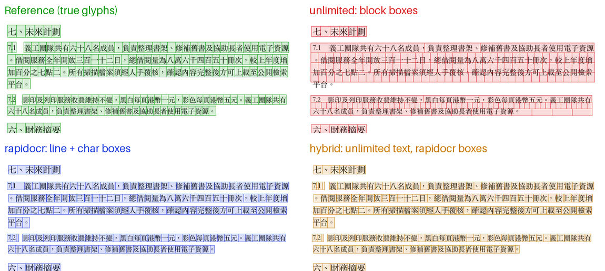

# Benchmark

All numbers below come from a corpus you can regenerate with the scripts in
`bench/`. The text is fictional and written for this benchmark.

## Corpus

`bench/make_corpus.py` lays out 30 A4 pages with a native text layer, records
every character's box as ground truth, and rasterizes each page into an
image-only PDF:

| Group | Pages | Content | Raster |
|---|---:|---|---|
| `para` | 10 | Traditional Chinese headings and numbered paragraphs | 150 dpi grayscale, JPEG q65 |
| `bilingual` | 6 | Alternating Traditional Chinese and English paragraphs | 150 dpi, q65 |
| `table` | 6 | A 15-row ruled table plus a paragraph | 150 dpi, q65 |
| `skew` | 4 | Paragraph pages rotated ±1.5° (references rotated with them) | 150 dpi, q65 |
| `lowres` | 4 | Paragraph pages | 120 dpi, JPEG q50 |

The published run used Songti TC (macOS). On Linux, Noto Serif CJK TC is picked
automatically. Every engine renders pages at 200 dpi through the same
`process_pdf`.

## Setup

- **`unlimited`:** Baidu Unlimited-OCR on vLLM, one GPU, on an aarch64 server
  shared with other workloads.
- **`rapidocr`:** PP-OCRv6 small (det/rec) plus the mobile direction
  classifier. ONNX Runtime CPU in a container with `--cpus 4` and
  `OCR_RAPIDOCR_THREADS=4` on the same aarch64 server, installed offline from a
  wheelhouse.
- **`hybrid`:** both recordings replayed through `hybrid_engine.merge` with
  `bench/replay_hybrid.py`. Its time is max(unlimited, rapidocr) + merge,
  because the hybrid engine runs RapidOCR while the model request is in flight.
  Merge itself averaged 5 ms per page (max 21 ms).

## Metrics

Whitespace and dot leaders are removed and NFKC is applied before scoring.

- **CER:** edit distance divided by reference characters. Reading-order
  differences count.
- **bag F1:** order-free character multiset F1.
- **center P50 / P90:** distance in points between each reference glyph's
  center and the text-layer character aligned to it. P50 and P90 are the
  per-page median and 90th percentile; the table shows the median over pages.
- **in box:** share of aligned text-layer character centers that fall inside
  the true glyph box. This is what you see when you search or select.

## Results

| engine | group | pages | recognize s/page | CER | bag F1 | center P50 (pt) | center P90 (pt) | in box |
|---|---|---:|---:|---:|---:|---:|---:|---:|
| unlimited | bilingual | 6 | 5.09 | 0.0% | 1.000 | 39.77 | 204.8 | 16.1% |
| unlimited | lowres | 4 | 7.80 | 0.2% | 0.998 | 79.10 | 297.5 | 6.6% |
| unlimited | para | 10 | 9.52 | 0.0% | 1.000 | 68.51 | 300.8 | 7.0% |
| unlimited | skew | 4 | 7.79 | 0.0% | 1.000 | 41.10 | 286.9 | 10.2% |
| unlimited | table | 6 | 5.31 | 0.3% | 0.997 | 23.47 | 74.0 | 18.9% |
| unlimited | all | 30 | 7.33 | 0.1% | 0.999 | 48.80 | 277.0 | 11.0% |
| rapidocr | bilingual | 6 | 1.80 | 0.1% | 0.999 | 1.93 | 2.4 | 97.8% |
| rapidocr | lowres | 4 | 2.15 | 0.3% | 0.997 | 0.73 | 1.4 | 98.9% |
| rapidocr | para | 10 | 2.31 | 0.1% | 0.999 | 0.97 | 1.7 | 99.4% |
| rapidocr | skew | 4 | 2.23 | 0.2% | 0.998 | 0.68 | 1.5 | 99.6% |
| rapidocr | table | 6 | 1.78 | 1.1% | 0.991 | 1.00 | 1.8 | 95.1% |
| rapidocr | all | 30 | 2.07 | 0.3% | 0.997 | 0.97 | 1.8 | 98.5% |
| hybrid | bilingual | 6 | 5.10 | 0.0% | 1.000 | 1.93 | 2.4 | 97.8% |
| hybrid | lowres | 4 | 7.80 | 0.2% | 0.998 | 0.72 | 1.4 | 99.4% |
| hybrid | para | 10 | 9.53 | 0.0% | 1.000 | 0.96 | 1.6 | 99.7% |
| hybrid | skew | 4 | 7.80 | 0.0% | 1.000 | 0.68 | 1.5 | 99.8% |
| hybrid | table | 6 | 5.31 | 0.3% | 0.997 | 0.99 | 1.8 | 94.8% |
| hybrid | all | 30 | 7.34 | 0.1% | 0.999 | 0.96 | 1.8 | 98.6% |



- **Recognition:** both engines are near-perfect on this clean corpus. Tables
  are the hardest group for RapidOCR, because cell text is read row by row.
- **Placement:** block grounding (`unlimited`) puts only about 1 in 9
  characters on its glyph. Characters drift across the block, and a short last
  line is stretched to the full block width. Line and character grounding
  (`rapidocr`, `hybrid`) puts about 98% on the glyph, typically within 1 pt.
- **Hybrid** keeps `unlimited`'s text exactly (identical CER) with
  `rapidocr`'s placement.

## Harder documents

On a separate private corpus of 34 dense, official-style pages (long
paragraphs, ruled tables, bilingual text, 1.5° skew), recognition differed much
more:

| Engine | CER (NFKC) | In box |
|---|---:|---:|
| unlimited | 4.3% | 22.1% |
| rapidocr, PP-OCRv6 small rec | 7.0% | 98.4% |
| rapidocr, PP-OCRv6 medium rec | 6.6% | 98.6% |
| rapidocr, PP-OCRv5 server rec (ch) | 7.6% | 95.9% |
| hybrid | 4.3% | 98.6% |

Typical RapidOCR errors there:

- Variant or Simplified forms of Traditional characters (虛→虚, 內→内).
- The em dash read as 一.
- Latin words inside Chinese sentences losing a letter.

The PP-OCRv5 server Chinese model outputs Simplified forms widely
(資→资, 試→试), so it is not recommended for Traditional text. PP-OCRv6 medium
removed the 虛→虚 errors at about 2.6× the small model's CPU time. **Validate
on your own documents**; the generated corpus above is optimistic.

## Reproduce

```sh
pip install -r requirements.txt -r requirements-rapidocr.txt -r bench/requirements.txt
python bench/make_corpus.py out
python bench/run_engine.py rapidocr out/corpus out/rapidocr
OCR_MODEL_BASE_URL=... python bench/run_engine.py unlimited out/corpus out/unlimited
python bench/replay_hybrid.py out/corpus out/unlimited out/rapidocr out/hybrid
python bench/evaluate.py out unlimited=out/unlimited rapidocr=out/rapidocr hybrid=out/hybrid --overlays para-02
```

Engines can be recorded on different machines; `run_engine.py` saves each
page's blocks as JSON. The service also includes `recordings.py`, which records
whole directories and replays them through the combiner.
